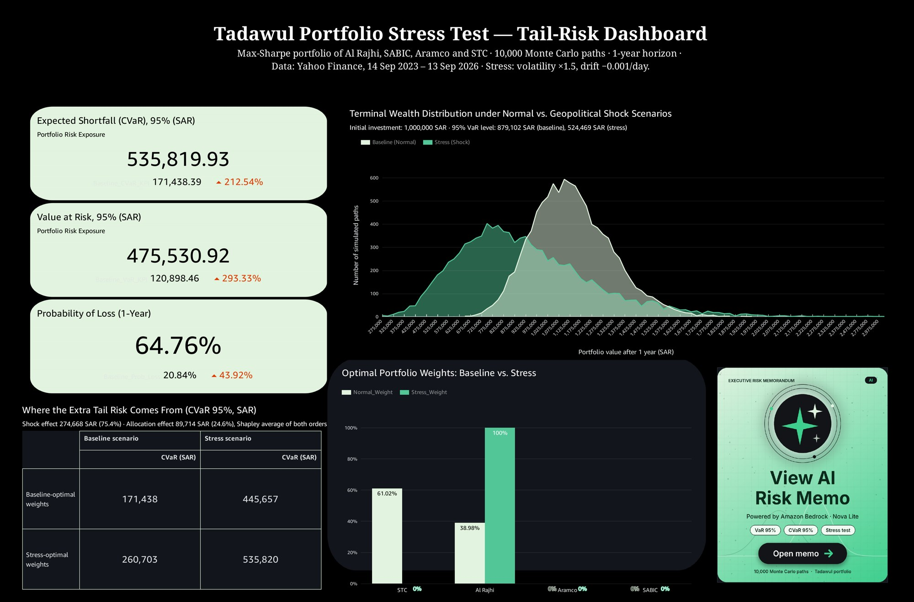
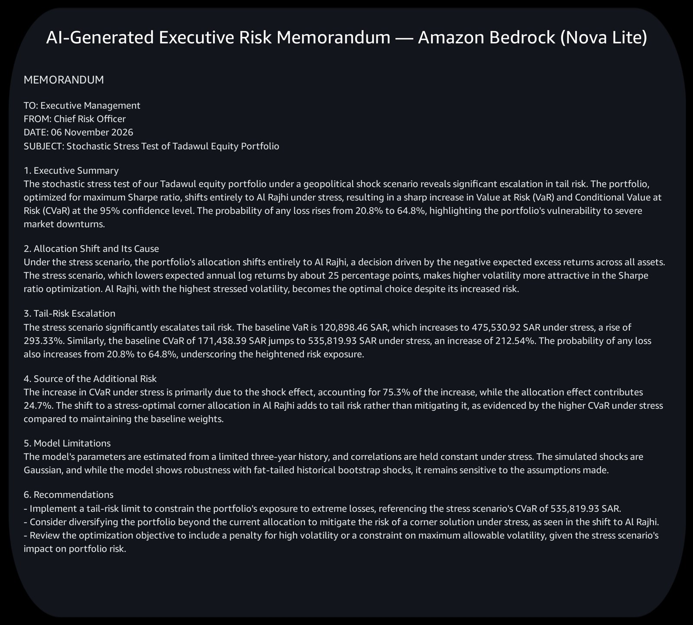
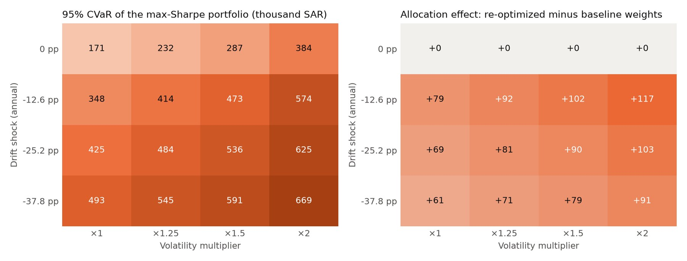
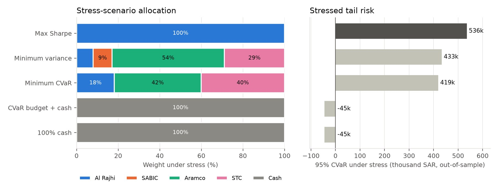
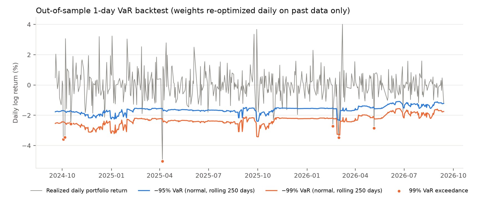

# Dynamic Portfolio Optimization & Tail-Risk Stress Testing (Tadawul)

A reproducible Python and AWS pipeline for portfolio optimization and stochastic tail-risk assessment on the Saudi Stock Exchange (Tadawul). It optimizes a long-only portfolio of four large equities, one leading company from each of four sectors (Al Rajhi Bank, SABIC, Saudi Aramco, STC), stress-tests it with 10,000 correlated Monte Carlo paths, decomposes the stressed tail risk, checks the results with a set of robustness and validation analyses, publishes them to an Amazon QuickSight dashboard and uses Amazon Bedrock (Nova Lite) to draft an executive risk memorandum whose figures are verified automatically.

Graduation project, Department of Statistics and Operations Research, King Saud University (2026).

## Method
* **Data:** adjusted daily prices, 14 Sep 2023 – 13 Sep 2026 (746 daily log returns), downloaded with `yfinance` and cached locally. The period excludes the 2020 crash so that the baseline describes a single post-pandemic market regime.
* **Optimization:** maximum Sharpe ratio (SLSQP, long-only, fully invested, risk-free rate 4.5%), with minimum-variance, minimum-CVaR (Rockafellar–Uryasev linear program, HiGHS), CVaR-budget-with-cash and 100%-cash alternatives.
* **Simulation:** correlated multivariate GBM via Cholesky, 252-day buy-and-hold horizon, 10,000 paths, common random numbers (seed 42). Stress scenario: daily drift −0.001 for every asset and volatility ×1.5, motivated by the regional conflict that began in late February 2026.
* **Risk measures:** 95% VaR and CVaR on the loss V₀ − V_T with bootstrap confidence intervals, probability of loss, and a variance-based normal benchmark.
* **Robustness and validation:** two-by-two decomposition with both orders and the Shapley average; 4 × 4 stress-sensitivity grid; crisis-correlation scenario; calibration against the 2020 COVID-19 crash and the 2026 regional-conflict window; circular block bootstrap; parameter bootstrap (500 resamples); out-of-sample 1-day VaR backtest with Kupiec and Christoffersen tests.

## Key Findings
* **Corner solution:** the baseline portfolio holds STC 61.0% and Al Rajhi 39.0%. Under stress the optimizer moves to 100% Al Rajhi, the most volatile asset, because every stressed excess return is negative and the Sharpe ratio then rewards volatility. Scaling the covariance matrix alone cannot change the weights; the corner is caused by the drift shock.
* **Tail-risk escalation:** 95% VaR rises from 120,898 to 475,531 SAR (+293.3%), 95% CVaR from 171,438 to 535,820 SAR (+212.5%), and the probability of a one-year loss from 20.8% to 64.8%.
* **The optimizer adds risk:** about 75% of the CVaR increase comes from the shock and about 25% from the optimizer's own reallocation (Shapley 75.4% / 24.6%). Keeping the baseline weights would give a stressed CVaR of 445,657 SAR. Re-optimizing adds risk in all 12 negative-drift cells of the sensitivity grid and in 71% of parameter resamples, and reduces it in none.
* **Alternatives and trade-offs:** a minimum-CVaR portfolio lowers stressed CVaR by about 22% (419,132 SAR) and is far less sensitive to estimation error, but it has a lower mean terminal value and a higher probability of loss (83.8% vs 64.8%), so losses are more frequent but less severe. When cash is allowed, the optimal stressed allocation is 100% cash.
* **Validation:** a block bootstrap gives lower, not higher, tail risk than the Gaussian model, and the daily VaR backtest does not reject the model at 95% or 99%. Parameter uncertainty (none of the four mean returns is significant) dominates simulation error.

## Visual Exhibits


*Figure 1: Amazon QuickSight dashboard: KPI cards, terminal-value distributions, optimal weights, the CVaR decomposition with Shapley shares, and the button that opens the AI memorandum.*


*Figure 2: Executive Risk Memorandum drafted by Amazon Bedrock (`amazon.nova-lite-v1:0`) from pre-computed figures and checked automatically for unsupported numbers.*


*Figure 3: Stressed CVaR of the re-optimized maximum-Sharpe portfolio and the allocation effect across 16 stress scenarios.*


*Figure 4: Stress-scenario allocation and out-of-sample CVaR by portfolio construction.*


*Figure 5: Out-of-sample 1-day VaR backtest, 18 Sep 2024 – 13 Sep 2026.*

## Files
| File | Purpose |
|---|---|
| `data_analysis.py` | Downloads and caches prices; log returns, μ, Σ, descriptive statistics and EDA figure |
| `portfolio_optimization.py` | Maximum-Sharpe and minimum-variance optimization; per-asset diagnostics |
| `monte_carlo.py` | Main pipeline: simulation, VaR/CVaR with bootstrap CIs, normal benchmark, 2×2 decomposition, QuickSight exports, AI memo |
| `extensions.py` | Robustness and validation analyses (Shapley, min-CVaR, grid, crisis and historical scenarios, block and parameter bootstraps, VaR backtest) |
| `ai_report_generator.py` | Amazon Bedrock memorandum with automated number verification |
| `manifest_*.json` | QuickSight S3 manifest files |

## Installation & Usage
```bash
git clone https://github.com/ghaliahalburaidi-cloud/Dynamic-Portfolio-Optimization-Tail-Risk-Stress-Testing-Tadawul-.git
cd Dynamic-Portfolio-Optimization-Tail-Risk-Stress-Testing-Tadawul-
pip install -r requirements.txt
python monte_carlo.py --bootstrap-shocks   # main results (add --no-ai to skip Bedrock)
python extensions.py                       # robustness and validation analyses
```
The first run downloads the price data and caches it locally; later runs reproduce the reported figures exactly. For the AI memorandum, copy `.env.example` to `.env` and add your AWS credentials (never commit `.env`).
